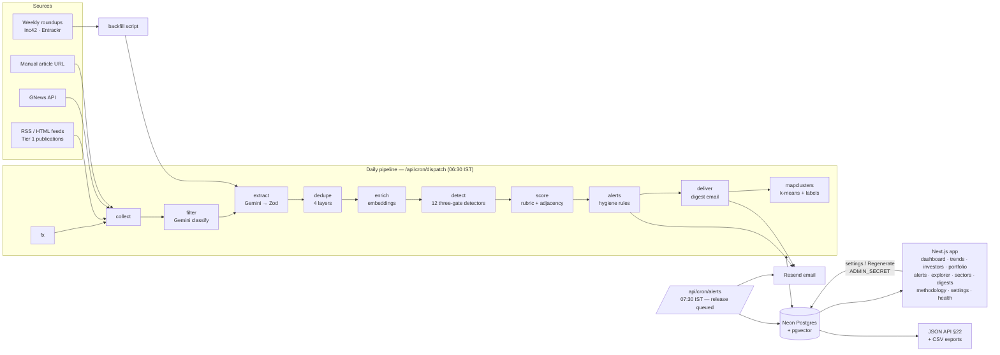

# Components Map

How Dealscope fits together: every component in the PRD, where it lives, what it
reads and writes, and how it fails. One daily cron drives the pipeline; a second releases
alerts held during quiet hours.

## Data flow

## Components

| Component | PRD | Files | Reads → writes | Degrades how |
|---|---|---|---|---|
| Source registry | §9.1, §20 | `seed/sources.json`, `src/scripts/seed.ts` | config → `sources` | Disabled sources keep their reason on `/health` |
| Collector | §9 | `src/pipeline/ingest/*` | feeds (robots.txt, crawl-delay) → `raw_articles` | Per-source isolation: a dead source is an error outcome; the run is `partial`, never aborted |
| FX | §9.4 | `src/lib/fx.ts` | Frankfurter → `fx_rates` | Failure logged; conversion uses the last stored rate |
| Filter (Stage A) | §10 | `src/pipeline/filter.ts`, `prompts/classify.v1.md` | `raw_articles` → verdicts | Gemini outage pauses the stage; articles stay `pending` |
| Extract (Stage B) | §10 | `src/pipeline/extract.ts`, `prompts/extract-*.md`, `src/pipeline/schemas.ts` | articles → `extracted_records` | Invalid output → `quarantine`, never a crash |
| Backfill | §19 | `src/pipeline/backfill.ts`, `prompts/extract-roundup.v1.md` | weekly roundups → `extracted_records` | Cross-check against live data logged |
| Normalise + dedupe | §10 C–D | `src/pipeline/normalize.ts`, `merge.ts`, `dedupe.ts`, `prompts/dedupe-adjudicate.v2.md` | records → `deals`, `deal_sources`, `events` | Idempotent; recompute-on-merge; funnel on `/health` |
| Enrich | §10 E | `src/pipeline/enrich.ts` | companies → embeddings, prior rounds | Missing embeddings skip vector layers only |
| Detectors | §14 | `src/pipeline/detect/*`, `src/config/detectors.ts` | SQL aggregates → `patterns`, `detector_runs` | Unmet history → **suppressed** with reason, shown on `/methodology` |
| Scoring + adjacency | §11, §13 | `src/pipeline/rubric.ts`, `score.ts`, `prompts/sector-fit.v1.md`, `prompts/adjacency.v1.md` | deals × profiles → `relevance_scores`, `adjacency_edges` | Time budget → continues next invocation; partial scores never written |
| Aggregates | §12 | `src/db/queries/aggregates.ts` | SQL only, `n` on every block | — |
| Alerts engine | §15 | `src/pipeline/alerts/policy.ts` (pure rules), `engine.ts`, `src/emails/alert.tsx` | edges, scores, events → `alerts` → email | UNIQUE dedupe key; one profile failing never blocks another; failed sends stay `pending` and retry |
| Narration | §10 I | `src/pipeline/narrate.ts`, `prompts/narrate-*.md` | aggregates + patterns → prose | Unsupported paragraphs rejected in code; Gemini down → digest ships with `narrationStatus: degraded` |
| Digest + delivery | §16–17 | `src/pipeline/digest.ts`, `deliver.ts`, `src/emails/*` | → `digests`, `digest_items`, email | Window advances only on success; one profile's failure isolated; last good digest at `/brief/latest` |
| Market maps | §18.6 | `src/pipeline/market-map.ts`, `prompts/market-map-label.v1.md` | company embeddings → `market_map_clusters` | Runs after delivery; labels fall back to the commonest sub-sector |
| Deep-dive | §18.6 | `src/pipeline/deep-dive.ts`, `prompts/sector-deep-dive.v1.md` | sector aggregates → prose (on demand) | Evidence-enforced; failure leaves the statistics on the page intact |
| NL search | §18.5 | `src/pipeline/nl-search.ts`, `prompts/nl-filter.v1.md`, `src/lib/deal-filters.ts` | question → validated filter object | Never SQL; Gemini down → manual filters still work |
| Web app | §18 | `src/app/*`, `src/components/*`, `src/db/queries/*` | DB reads; settings writes behind `ADMIN_SECRET` | Route error boundary (no stack traces) links the latest brief |
| API | §22 | `src/app/api/*` | public reads; secret-gated mutations and cron | 503 JSON with a short message, never internals |
| Dispatcher | §21 | `src/pipeline/dispatch.ts`, `src/app/api/cron/dispatch` | stage chain with cursors and self-continuation | A throwing stage is logged and skipped; the chain continues |
| Observability | §18.9 | `src/lib/logger.ts`, `run-log.ts`, `src/app/health` | `run_logs`, `quarantine` | `/health` reports failures as-is |

## Scheduling

| Cron (UTC) | IST | Route | Does |
|---|---|---|---|
| `0 1 * * *` | 06:30–07:29 | `/api/cron/dispatch` | Full pipeline, alerts evaluation, due digests, market maps |
| `0 2 * * *` | 07:30–08:29 | `/api/cron/alerts` | Releases alerts queued during quiet hours (22:00–07:00) and evaluates new ones |

Vercel Hobby fires a daily cron at any point within its hour, hence the ranges.
